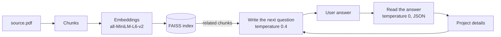

# RAG Conversational AI Assistant

A chat assistant that helps a business owner plan a website. It asks one question at a time
(name, type of website, goal, audience, style, features, content and technical needs) and
at the end it saves a short summary of the requirements.

It uses RAG: during the conversation it searches a small PDF about web design and uses what it
finds to ask better questions, and to give options when the user is not sure.

Everything runs locally with Llama 3.1 8B through Ollama.

> This is a simplified public version of a project I worked on during my internship.
> It does not contain any company code, documents or prompts.

## How it works



1. **Knowledge base.** The PDF is split into chunks, turned into embeddings and stored in a FAISS
   index. The index is saved in `data/faiss_index`, so it is only built on the first run.
2. **Reading the answer.** The model takes the part of the answer that matters and says if the user
   really answered. If the user is not sure, or answers with a question, the assistant asks again
   and offers two or three options from the PDF.
3. **Asking the next question.** The model gets the answers so far and the related parts of the PDF,
   and writes one short question.
4. **Summary.** At the end the answers are printed and saved to `project_requirements.txt`.

## Model settings

The same model is used with two different settings, because the two tasks are different:

| Task | Settings | Why |
|---|---|---|
| Reading the answer | `temperature=0`, `format="json"` | There is only one correct result, so no randomness |
| Writing the question | `temperature=0.4`, `top_p=0.9`, `top_k=40`, `repeat_penalty=1.1` | The question should sound natural |

The code also checks the model's output instead of trusting it:

- the extracted value must really be in the user's answer, otherwise the full answer is saved
- only the first question is kept, and if there is no usable question, a simple fixed one is used

## Run it

1. Install [Ollama](https://ollama.com) and download the model:

   ```bash
   ollama pull llama3.1:8b
   ```

2. Install the Python packages:

   ```bash
   pip install -r requirements.txt
   ```

3. Run it from the project folder:

   ```bash
   python src/rag_app.py
   ```

Type `exit` to stop at any time. To use another Ollama model, set the `OLLAMA_MODEL`
environment variable, for example `OLLAMA_MODEL=qwen2.5:1.5b`.

## Example

Part of a test run (with the small `qwen2.5:1.5b` model):

```text
Assistant: ... First, what is the name of your project or business? 😊
You: BOOKAPO
Assistant: What kind of website are you envisioning for BOOKAPO?
You: an online bookstore
...
Assistant: What kind of visual style do you envision for your online bookstore?
You: I am not sure
Assistant: You mentioned that you're unsure about the visual style for your online bookstore project.
Would you prefer a minimalist approach with generous whitespace, limited decorative elements, and a
restrained color palette?
You: minimal
```

The options in the last question come from the PDF (section "Visual Design Principles").

## Project structure

```text
rag-conversational-ai/
├── data/
│   ├── README.md
│   └── source.pdf      # knowledge base for RAG
├── src/
│   └── rag_app.py      # the whole app
├── requirements.txt
└── README.md
```

## Research results

The full system was evaluated in the associated master's thesis across 18 user dialogues:

- **89%** requirement completeness
- **0.87** average semantic fidelity
- **4.4/5** follow-up relevance

The thesis also evaluated websites generated from the collected requirements (4.7/5 design
fidelity, about 92% of functional requirements covered) and compared this local setup with a
cloud setup (Vertex AI, AlloyDB/pgvector). Website generation and the cloud setup are not part of
this repository, so these numbers can't be reproduced from this simplified version.

## Author

**Behnaz Mohammadi**

AI Engineer & Data Scientist focused on Generative AI, LLMs, RAG, NLP and Machine Learning.

- LinkedIn: https://www.linkedin.com/in/behnaz-mohammadi/
- Google Scholar: https://scholar.google.com/citations?user=HTUZKqIAAAAJ&hl=en
